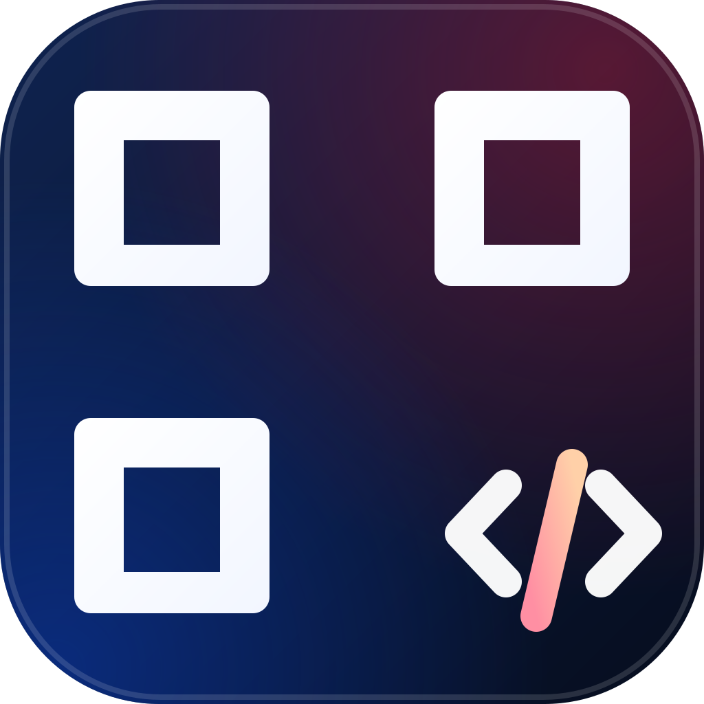
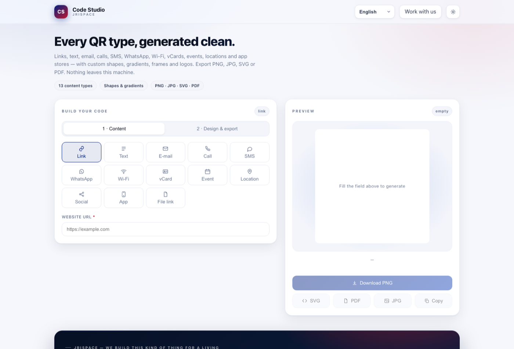

<div align="center">



# Code Studio

**Every QR type, generated clean — offline, installable, in five languages.**

[](https://codestudio.jrispace.com)
[](#install-as-an-app)
[](#security)
[](#languages)
[](#privacy)

[Live app](https://codestudio.jrispace.com) · [Report an issue](https://github.com/jrispace/code-studio/issues) · [JRiSpace](https://jrispace.com)



</div>

---

## What it is

A complete QR code studio that runs entirely in the browser. One HTML file, no build server, no
analytics, no network calls — the QR encoder itself is vendored and inlined, so a generated code
never leaves the device. It installs as a Progressive Web App and keeps working offline.

Thirteen content types, real design control (shapes, gradients, corners, frames, logos) and four
export formats. Built for people who need a code today, not an account.

## Features

**Content — 13 types, all standards-compliant payloads**

| Type | Encodes |
|------|---------|
| Link · Text | `https://…` (auto-normalised) · any UTF-8 text |
| E-mail | `mailto:` with subject and body |
| Call · SMS | `tel:` · `SMSTO:` with a pre-filled message |
| WhatsApp | `wa.me` deep link with a pre-filled message |
| Wi-Fi | `WIFI:T:…;S:…;P:…;H:…;;` — joins the network on scan |
| vCard | full vCard 3.0 (name, phones, e-mail, company, address, note) |
| Event | iCalendar `VEVENT` — opens in the calendar app |
| Location | `geo:` coordinates |
| Social | multi-profile text block |
| App | App Store / Google Play links |
| File link | any public PDF, image or video URL |

**Design**

- Five module shapes — square, rounded, dots, diamond, classy — with neighbour-aware rounding
- Three corner styles (square, rounded, circle) and an independent corner colour
- Solid, linear or radial gradient, any angle; transparent background
- Optional frame with a caption ("SCAN ME"), three font families, custom colours
- Centre logo with an automatic clear plate; error correction is forced to `H` when a logo is added

**Export** — PNG (100–4000 px, exact size), JPG, SVG (vector, print-ready), PDF (embedded raster),
copy-to-clipboard, and a live preview that always matches the file you get.

**Everything else** — 13 types · five languages · light/dark · keyboard accessible · no cookies,
no localStorage beyond a theme/language preference.

## Install as an app

The site is a PWA: open [codestudio.jrispace.com](https://codestudio.jrispace.com) in Chrome and use
**Install** in the address bar (or the install button in the app). It then launches in its own
window, works offline, and keeps the QR library cached via a service worker.

## Languages

English is the source language; Kreyòl, Français, Español and Português ship alongside it.

Resolution order: `?lang=xx` in the URL → the language you picked in the switcher → your browser's
language → English. Deep-link any of them:
`codestudio.jrispace.com/?lang=ht` · `?lang=fr` · `?lang=es` · `?lang=pt`

## Quick start (local)

```bash
git clone https://github.com/jrispace/code-studio.git
cd code-studio
open index.html            # works straight from disk, no server needed
```

For the PWA and service worker you need a secure context, so serve it instead:

```bash
python3 -m http.server 8791 --bind 127.0.0.1
# → http://127.0.0.1:8791/index.html
```

## Build

`index.html` is generated — never edit it by hand.

```bash
python3 build.py
```

The build:

1. inlines `lib/qrcode.js`, `src/i18n.js` and `src/app.js` into `src/app.html`;
2. hashes every inline `<script>` and `<style>` and writes a strict
   `Content-Security-Policy` meta tag pinned to those SHA-256 digests.

| Path | Role |
|------|------|
| `src/app.html` | markup, styles and the shell |
| `src/app.js` | rendering, payload builders, exports, screening chat |
| `src/i18n.js` | the five language tables |
| `lib/qrcode.js` | qrcode-generator v1.4.4 (Kazuhiko Arase, MIT) — vendored, inlined |
| `build.py` | the build + CSP generator |
| `index.html` | build output (what gets hosted) |
| `sw.js`, `manifest.webmanifest`, `icons/` | PWA layer |
| `assets/logo.svg` | source logo (icons are rasterised from it) |

## Architecture notes

- **One file, no framework.** ~2 500 lines of plain ES5-compatible JavaScript; nothing to install,
  nothing to keep updated, nothing that breaks offline.
- **Renderer, not a library.** Dark modules are converted to path data once, then drawn to canvas or
  emitted as SVG from the same geometry — so PNG, JPG, PDF and SVG are guaranteed identical.
- **PDF without dependencies.** A ~40-line writer embeds the JPEG into a valid PDF (6 objects) — no
  pdf.js, no server.
- **i18n with fallback.** Every key falls back to English, so a missing translation degrades instead
  of breaking.

## Security

- Strict **hash-pinned CSP** (`default-src 'none'`, no `unsafe-inline`, no `unsafe-eval`), generated by
  the build so it can never drift from the code.
- All user text is escaped (`& < > " '`) before it reaches the DOM; inputs are length-capped
  (`maxlength` + code-level slices); uploads are gated on MIME type and an 8 MB ceiling.
- Zero third-party requests: the QR library is vendored, `connect-src 'self'`, `frame-src 'none'`.
- Security headers are applied at the Cloudflare edge (GitHub Pages cannot send them): HSTS,
  `X-Content-Type-Options`, `X-Frame-Options: DENY`, `Referrer-Policy`, `Permissions-Policy`,
  `Cross-Origin-Opener-Policy`, `Cross-Origin-Resource-Policy`.
- Verified with the agency gate: `~/scripts/ai-security-check.sh .` → 0 blocking findings.
  Two reviewed advisories remain (template-built field markup whose values all pass through the
  escaper) — documented above rather than hidden.

Verify the live headers yourself:

```bash
curl -sI https://codestudio.jrispace.com/ | grep -iE 'strict-transport|content-security|x-content|x-frame|referrer|permissions|cross-origin'
```

## Privacy

No analytics, no cookies, no accounts, no uploads. The only data that leaves the browser is the text
you yourself send when you press **Open WhatsApp** — and the only stored values are your
theme and language choice, in `localStorage`.

## Hosting

GitHub Pages from `main` / root, custom domain `codestudio.jrispace.com`:

- `CNAME` pins the custom domain for Pages.
- DNS (`jrispace.com` zone on Cloudflare): `CNAME codestudio → jrispace.github.io`, **proxied**, so
  Cloudflare terminates TLS with the `*.jrispace.com` certificate, forwards to GitHub over HTTPS and
  attaches the security headers above.

## Contributing

Issues and pull requests are welcome. Please run `python3 build.py` before committing (the committed
`index.html` must match the sources) and keep the CSP hashes intact — the build regenerates them.

## License

Source code: **MIT** — see [LICENSE](LICENSE).
Vendored `lib/qrcode.js`: MIT © Kazuhiko Arase.
"QR Code" is a registered trademark of DENSO WAVE INCORPORATED.

---

<div align="center">
Built by <a href="https://jrispace.com">JRiSpace</a> — <strong>Sylvenson Richard</strong>
</div>
